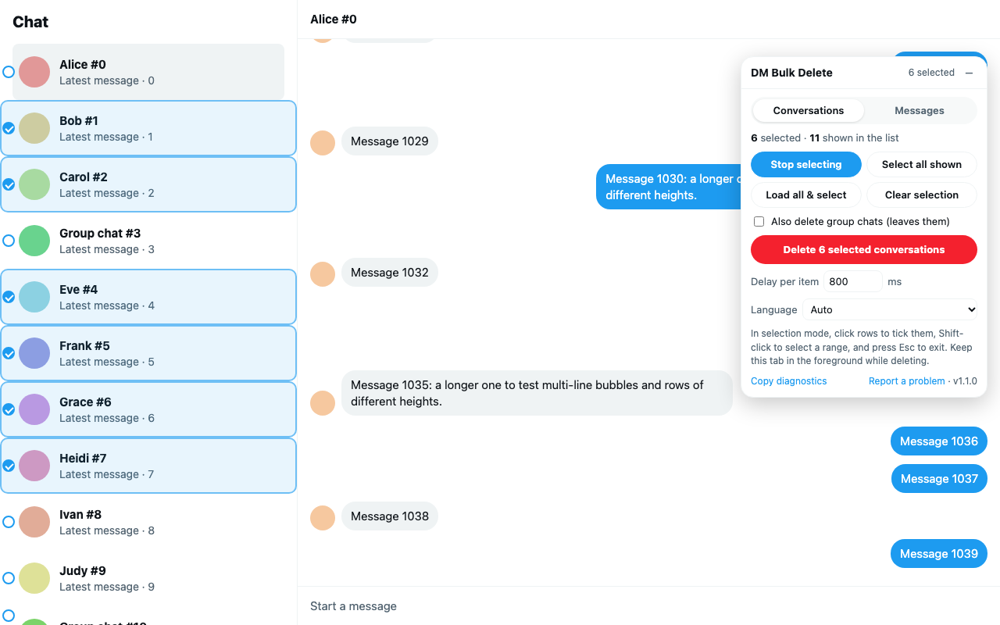
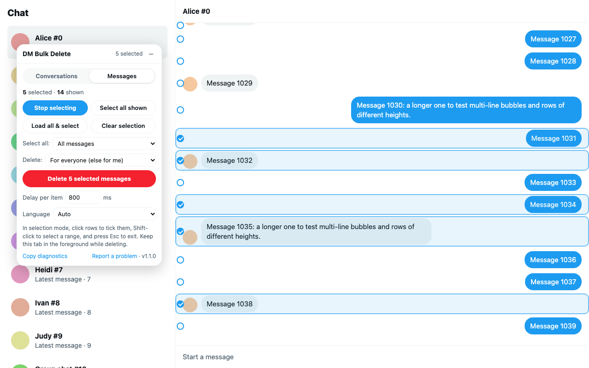
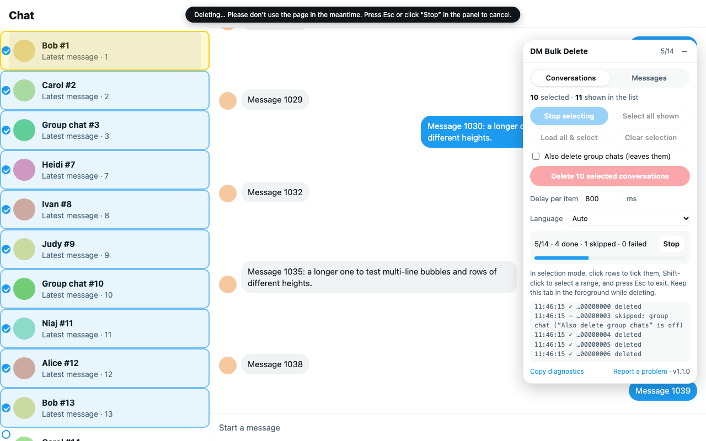

<p align="center"></p>
<h1 align="center">DM Bulk Delete for X</h1>
<p align="center">Tick many X (Twitter) direct messages, or whole conversations, and delete them in one go — right on X’s messages page.</p>
<p align="center">
  <a href="https://chromewebstore.google.com/detail/dm-bulk-delete-for-x/ohiiccddhenbgfbgachigngnggjcgoeo"><b>Chrome Web Store</b></a> ·
  <a href="https://greasyfork.org/en/scripts/604053-dm-bulk-delete-for-x"><b>Greasy Fork</b></a> ·
  <a href="https://llln-j.github.io/x-dm-bulk-delete/"><b>Website</b></a>
</p>
<p align="center"><b>English</b> · <a href="README.zh-CN.md">简体中文</a></p>



X only lets you delete direct messages one at a time: its messages page (now called Chat, at `x.com/i/chat`) has no way to select several and delete them together. DM Bulk Delete for X adds a floating panel to that page so you can:

- **Delete whole conversations in bulk**: tick several conversations in the list and delete them all at once. Message requests work too, and you can choose to include group chats (which means leaving them).
- **Delete individual messages in bulk**: tick messages inside a conversation and delete them just for you, or for everyone.

It runs entirely in your browser: it makes no network requests of its own, uses no analytics, and no data leaves your device. It’s free and open source under the MIT License.

> [!WARNING]
> Deletion is permanent. There is no undo, and the extension keeps no copy of anything it deletes. Save anything you might need before you start — see [Before you start](#before-you-start).

[Install](#install) · [Usage](#usage) · [Before you start](#before-you-start) · [How it works](#how-it-works) · [Privacy and permissions](#privacy-and-permissions) · [Troubleshooting](#troubleshooting) · [Development](#development) · [License](#license)

## Install

| Option | How to install |
| --- | --- |
| **Chrome Web Store**<br>Chrome and other Chromium-based browsers | Open the [Chrome Web Store listing](https://chromewebstore.google.com/detail/dm-bulk-delete-for-x/ohiiccddhenbgfbgachigngnggjcgoeo) and click **Add to Chrome**. Your browser keeps it up to date. |
| **Userscript**<br>Chrome, Edge, Firefox, Safari | Install a userscript manager such as [Tampermonkey](https://www.tampermonkey.net/) or [Violentmonkey](https://violentmonkey.github.io/). Then either open the script on [Greasy Fork](https://greasyfork.org/en/scripts/604053-dm-bulk-delete-for-x) and click **Install this script**, or use the [one-click install link](https://raw.githubusercontent.com/LLLn-J/x-dm-bulk-delete/userscript/x-dm-bulk-delete.user.js) straight from GitHub. Pick one source; your manager keeps the script up to date. In Chrome and Edge, the manager may first ask you to allow user scripts — follow its instructions. |
| **Manual install**<br>Chrome, load unpacked | Download the zip from [Releases](https://github.com/LLLn-J/x-dm-bulk-delete/releases/latest) and unzip it → open `chrome://extensions` → turn on **Developer mode** → click **Load unpacked** and choose the unzipped folder. Manual installs don’t update themselves, so check Releases for new versions. |

Once it’s installed, open <https://x.com/i/chat>. The **DM Bulk Delete** panel appears at the top right of the page.

## Usage

### Delete whole conversations

1. In the panel, choose **Conversations** and click **Start selecting**.
2. Click conversations in the list on the left to tick them, and click again to untick. Shift-click ticks a whole range.
   - **Select all shown** ticks every conversation currently shown in the list.
   - **Load all & select** scrolls down for you, loading all your conversations and ticking every one.
3. On X, deleting a group chat means leaving it, so group chats are skipped by default. Tick **Also delete group chats (leaves them)** to include them.
4. Click **Delete N selected conversations**. The button changes to **Click again to delete … (can’t be undone)**; click it once more to start.

### Delete individual messages



1. Open a conversation, choose **Messages** in the panel and click **Start selecting**.
2. Click message rows to tick them (Shift-click for a range), or use **Select all shown** or **Load all & select**, which first scrolls up to load the chat’s full history. **Select all** can be limited to **All messages**, **Only mine** or **Only theirs**.
3. Under **Delete**, choose how the messages go:
   - **For me only** removes them from your side only; the other person can still see them. Works on any message.
   - **For everyone (else for me)** deletes your own messages for everyone, and falls back to “for me” for messages that can’t be deleted for everyone, such as the other person’s.
   - **For everyone only (else skip)** deletes for everyone where possible and skips everything else.
4. Click **Delete N selected messages**, then click again to confirm.

### While it runs



- A transparent overlay covers the page so a stray click can’t interrupt the run. Press **Esc** or click **Stop** in the panel at any time.
- Keep the tab in the foreground. While the page isn’t on screen (the tab is in the background or the window is covered), the run pauses, and it resumes when you come back.
- Items are processed 800 ms apart by default, with random jitter. You can change **Delay per item**, but when deleting a lot, don’t set it too low, or X may rate-limit you.
- Failed items are marked red and stay ticked, so you can simply start the delete again. After 3 failures in a row, the run stops automatically.
- The panel shows progress (done, skipped, failed) and a timestamped log of every item.

The panel is in English or Chinese. It follows X’s interface language (falling back to your browser’s language) and can be switched under **Language** in the panel.

## Before you start

- **Deletion is permanent.** Deleted messages and conversations can’t be restored, and the extension makes no backup.
- **Save what you want to keep first.** For example, request your X data archive (**Settings → Your account → Download an archive of your data**) and check that it contains what you need before you delete anything.
- **Other people keep their copies.** **For me only** doesn’t remove a message for the other person, and deleting a conversation only removes it from your inbox; the other participants can still see it.
- **“For everyone” only works on messages you sent.** Group admins can also delete other people’s messages in groups they manage.
- **This is not an official X tool.** It works through X’s own web interface, so an X update can break it until the extension is updated.

## How it works

X’s direct messages now run on X Chat, which is end-to-end encrypted: every delete request has to be signed by your own client with your keys, so it can’t simply be sent to an API. Instead, the extension uses X’s own interface in your browser and clicks through the same steps you would by hand. For a message it opens **More → Delete** and chooses deleting for you or for everyone; for a conversation it right-clicks it, chooses **Delete conversation** and confirms. The deletions themselves are carried out by X’s web app, exactly as if you had clicked.

X Chat renders inside a shadow DOM. The element markers the extension relies on (such as `data-testid`) and the button labels in all 42 of X Chat’s interface languages are taken from X Chat’s own front-end code.

## Privacy and permissions

Everything happens inside your browser. The extension makes no network requests of its own, uses no analytics, ads or third-party services, and doesn’t read or store message text. All of its code ships in the package; nothing is loaded remotely.

- **`storage` permission** — the only permission the extension declares. It saves your panel settings (delete mode, delay, panel position) on your device in `chrome.storage.local`. Nothing is synced, and uninstalling the extension removes them. The userscript keeps the same settings in the page’s `localStorage`.
- **Site access to `x.com` and `twitter.com` only** — the content script runs on `https://x.com/*` and `https://twitter.com/*` and nowhere else, and the extension asks for no other site access. When you install it, Chrome lists this as being able to read and change your data on those two sites. That access is what lets it show the panel and click X’s menus for you; the panel itself only appears on the messages page, `x.com/i/chat`. The userscript runs on the same two sites.
- **What it reads** — the page’s internal IDs for your conversations and messages, where they sit on the page, and whether each message was sent by you. This stays in the page’s memory and is gone when you close or reload the tab.

The full policy is in [PRIVACY.md](PRIVACY.md).

## Troubleshooting

- **The panel doesn’t appear**: make sure you’re on `x.com/i/chat`; the panel only shows on the messages page.
- **“No conversation list on this page”**: in a narrow window, go back to the conversation list first.
- **The run stopped after 3 failures in a row**: X may have changed its interface or rate-limited you. Try again later, perhaps with a longer **Delay per item**.
- **It stopped working after an X update**: click **Copy diagnostics** at the bottom of the panel and paste the result into a [new issue](https://github.com/LLLn-J/x-dm-bulk-delete/issues/new/choose). Diagnostics contain only page-structure counts and the log, never message content.

## Development

```text
x-dm-bulk-delete/        The extension itself (load this folder in Chrome)
  manifest.json, _locales/, popup.html, popup.js, icons/
  src/labels.js          Button labels in X Chat's 42 interface languages (generated by tools/update_labels.py)
  src/core.js            Queries that pierce the shadow DOM, simulated mouse events, settings storage
  src/i18n.js            Panel text (Chinese / English) and interface-language detection
  src/xchat.js           X Chat's page structure and the deletion flows
  src/ui.js              Panel, tick marks, selection mode, delete queue
  src/main.js            Entry point
test/                    Local test page that mimics X Chat's structure
store/                   Store screenshots, promo images and listing copy
tools/                   Scripts for packaging, generating store assets and updating labels
docs/                    Landing page (GitHub Pages) and PUBLISHING.md (release process)
```

- **Local testing**: in the project root, run `python3 -m http.server 8765` and open <http://localhost:8765/test/mock-xchat.html>. Add `?lang=en` for the English interface, `?variant=old` for the old message menu, or `?userscript` to load the built userscript from `dist/` instead of the extension source (run the build first).
- **Build**: `python3 tools/build.py` checks the manifest, description lengths and JavaScript syntax, then writes the store zip and the userscript to `dist/`. CI runs the same command.
- **Store assets**: `python3 tools/make_store_assets.py` (needs Chrome installed locally).
- **Button labels**: when X changes its wording, run `python3 tools/update_labels.py`.
- **Landing page**: plain static files in `docs/`, published by GitHub Pages from `main` → `/docs`. The Chrome Web Store link is set in `docs/config.js`. To preview, run `python3 -m http.server 8000 --directory docs` and open <http://localhost:8000/>.
- **Releasing**: see [docs/PUBLISHING.md](docs/PUBLISHING.md) (in Chinese).

## License

[MIT](LICENSE). This project is not affiliated with or endorsed by X Corp. and is not an official X product. “X” is a trademark of X Corp.
