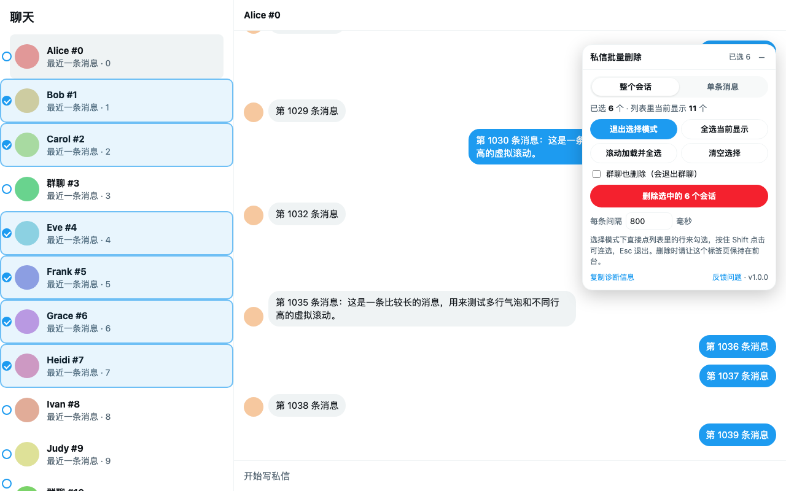
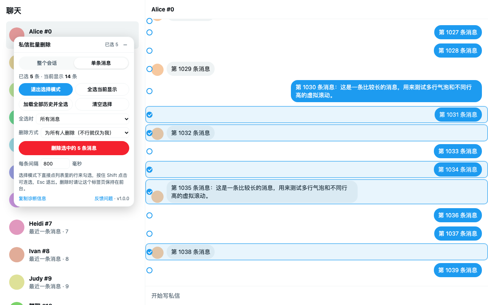
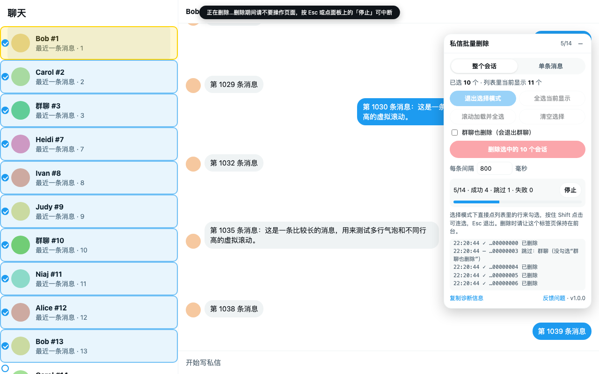

<p align="center"></p>
<h1 align="center">X 私信批量删除</h1>
<p align="center">在 X（Twitter）私信页批量勾选并删除单条消息或整个会话<br><a href="#english">English</a></p>



X 的私信（现在叫 Chat，地址 `x.com/i/chat`）只能一条条删。这个扩展在私信页加一个悬浮面板，让你：

- **批量删除整个会话**：在会话列表里勾选多个，一次删完；「消息请求」列表同样支持；群聊可选择一并退出
- **批量删除单条消息**：在对话里勾选多条，可选「仅为我删除」或「为所有人删除」

## 安装

| 方式 | 步骤 |
| --- | --- |
| **Chrome 网上应用店** | 审核中，通过后在这里放链接 |
| **油猴脚本**（Chrome / Edge / Firefox / Safari） | 先装 [Tampermonkey](https://www.tampermonkey.net/) 或 [Violentmonkey](https://violentmonkey.github.io/)，再点 [一键安装](https://raw.githubusercontent.com/LLLn-J/x-dm-bulk-delete/userscript/x-dm-bulk-delete.user.js)，之后会自动更新 |
| **手动加载** | 从 [Releases](https://github.com/LLLn-J/x-dm-bulk-delete/releases/latest) 下载 zip 并解压 → 打开 `chrome://extensions` → 打开「开发者模式」→「加载已解压的扩展程序」选解压出的文件夹 |

装好后打开 <https://x.com/i/chat>，页面右上角会出现「私信批量删除」面板。

## 使用

### 删除整个会话

1. 面板切到「整个会话」，点「进入选择模式」
2. 直接点左侧列表里的会话来勾选；再点一次取消，按住 Shift 点击可以连选一段
   - 「全选当前显示」：勾选列表里正显示的会话
   - 「滚动加载并全选」：自动往下滚动，加载全部会话并全部勾选
3. 群聊在 X 里对应的是「离开对话」，默认跳过；勾上「群聊也删除（会退出群聊）」才会处理
4. 点「删除选中的 N 个会话」，按钮变红后再点一次确认

### 删除单条消息



1. 先打开一个对话，面板切到「单条消息」，进入选择模式
2. 点消息行勾选（Shift 连选），或用「全选当前显示」「加载全部历史并全选」；「全选时」可限定只选我发的或只选对方发的
3. 选删除方式：
   - **仅为我删除**：只从你这边消失，对方仍能看到；任何消息都能这么删
   - **为所有人删除（不行就仅为我）**：自己发的消息为所有人删除，对方的消息退回为仅为我删除
   - **只为所有人删除（不行就跳过）**：对方的消息直接跳过
4. 点删除并再次确认

### 删除过程中



- 页面被一层透明遮罩挡住，防止误触打断流程；按 Esc 或点「停止」随时中断
- 请让标签页保持在前台，切到后台会自动暂停，切回来继续
- 每条默认间隔 800 毫秒（带随机抖动），数量很多时别调太低，以免触发 X 的频率限制
- 失败的项目标红并保持勾选，可直接再删一次；连续失败 3 次会自动停下

## 工作原理

X 的私信现在是端到端加密的 X Chat，删除请求需要客户端用你的密钥签名，直接调接口做不到。所以扩展做的是：在 X 自己的界面上替你依次点「更多 → 删除 → 只有我 / 每个人」，会话则是「右键 → 删除对话 → 确认」，和手动操作完全一样，只是自动化了。

X Chat 渲染在 shadow DOM 里，扩展用的元素标识（`data-testid` 等）和 42 种界面语言的按钮文字，都取自 X Chat 前端代码本身。

## 注意

- 删除不可撤销
- 「为所有人删除」只对你自己发的消息有效（群管理员在自己管理的群里也能删别人的）
- 「仅为我删除」不会让对方那边的消息消失；删除会话也只是从你的收件箱移除，对方仍能看到
- 面板界面目前只有简体中文
- X 改版后如果失效，请点面板底部「复制诊断信息」，[提交 issue](https://github.com/LLLn-J/x-dm-bulk-delete/issues/new/choose) 时贴上（里面只有页面结构统计和日志，不含消息内容）

## 隐私

所有处理都在你的浏览器里完成：不发任何网络请求，数据不会离开你的设备，只用 `storage` 权限保存面板设置。详见 [PRIVACY.md](PRIVACY.md)。

## 开发

```
x-dm-bulk-delete/        扩展本体（Chrome 里加载这个文件夹）
  manifest.json, _locales/, popup.html, popup.js, icons/
  src/labels.js          42 种界面语言的按钮文字（tools/update_labels.py 生成）
  src/core.js            穿透 shadow DOM 的查询、模拟鼠标事件、设置存储
  src/xchat.js           X Chat 的页面结构和删除流程
  src/ui.js              面板、勾选标记、选择模式、删除队列
  src/main.js            入口
test/                    仿 X Chat 结构的本地测试页
store/                   商店截图、宣传图和上架文案
tools/                   打包、生成素材、更新文案的脚本
docs/PUBLISHING.md       发布流程
```

- **本地测试**：在项目根目录运行 `python3 -m http.server 8765`，打开 <http://localhost:8765/test/mock-xchat.html>。参数 `?lang=en` 切英文界面，`?variant=old` 切旧版消息菜单，`?userscript` 改为加载打包后的油猴脚本
- **打包**：`python3 tools/build.py`，在 `dist/` 生成商店 zip 和油猴脚本
- **商店素材**：`python3 tools/make_store_assets.py`（需要本机装有 Chrome）
- **更新按钮文字**：X 改了文案时运行 `python3 tools/update_labels.py`
- **发布**：见 [docs/PUBLISHING.md](docs/PUBLISHING.md)

## 许可证

[MIT](LICENSE)。本项目与 X Corp. 无关，不是 X 官方产品；X 是 X Corp. 的商标。

---

<a id="english"></a>

## English

**DM Bulk Delete for X** adds a floating panel to X's messages page (`x.com/i/chat`) so you can tick many messages or whole conversations and delete them in one go. X itself only lets you delete them one at a time.

- **Install**: Chrome Web Store (link coming after review), [userscript one-click install](https://raw.githubusercontent.com/LLLn-J/x-dm-bulk-delete/userscript/x-dm-bulk-delete.user.js) for Tampermonkey / Violentmonkey, or download the zip from [Releases](https://github.com/LLLn-J/x-dm-bulk-delete/releases/latest) and use "Load unpacked" on `chrome://extensions`.
- **Use**: open `x.com/i/chat`, pick "整个会话" (conversations) or "单条消息" (messages), click "进入选择模式" (selection mode), tick rows (Shift-click for ranges, or the select-all buttons), then click the red delete button twice. Esc stops a run at any time.
- **How it works**: X DMs are end-to-end encrypted and deletions must be signed by the client, so the extension simply clicks through X's own menus for you. It recognises the menu labels in all 42 interface languages of X Chat.
- **Privacy**: everything runs in your browser. No network requests and no data leaves your device; the only permission is `storage` for panel settings. See [PRIVACY.md](PRIVACY.md).
- **Notes**: deletion cannot be undone; "Delete for everyone" only works on your own messages; the panel's interface is currently in Simplified Chinese.

MIT licensed. Not affiliated with or endorsed by X Corp.
