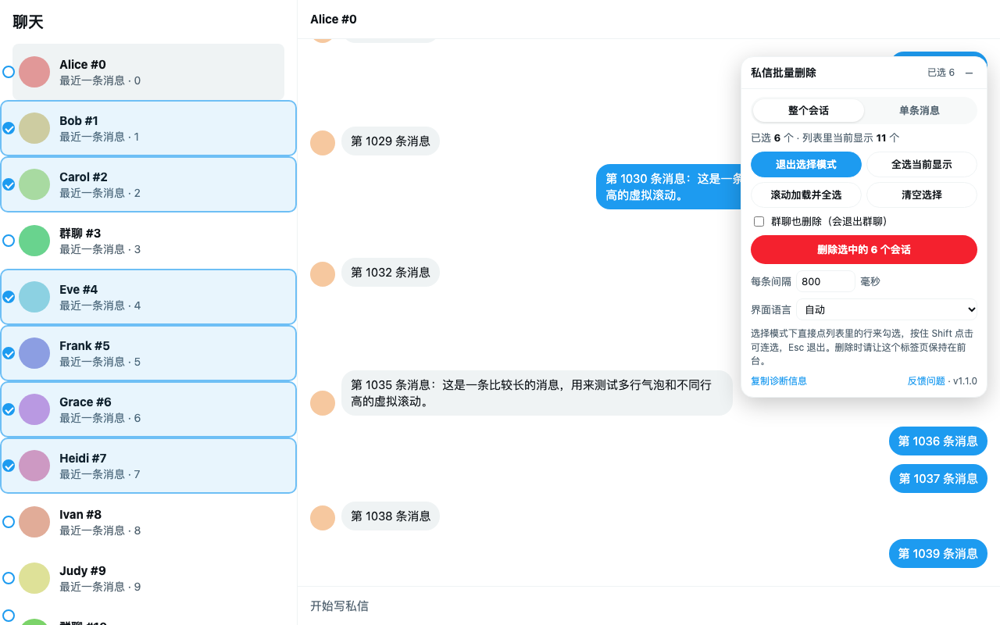
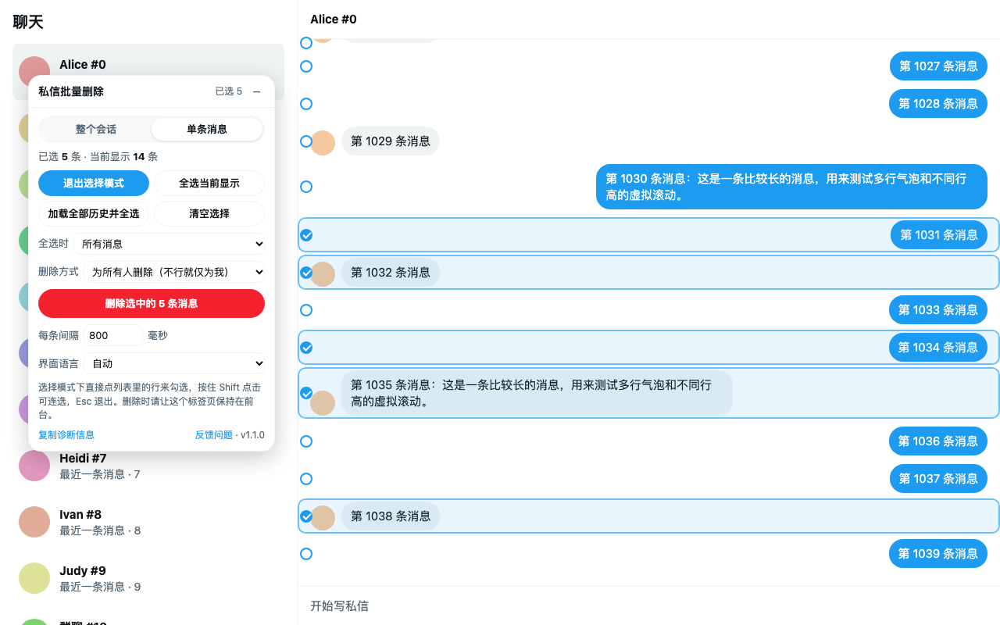
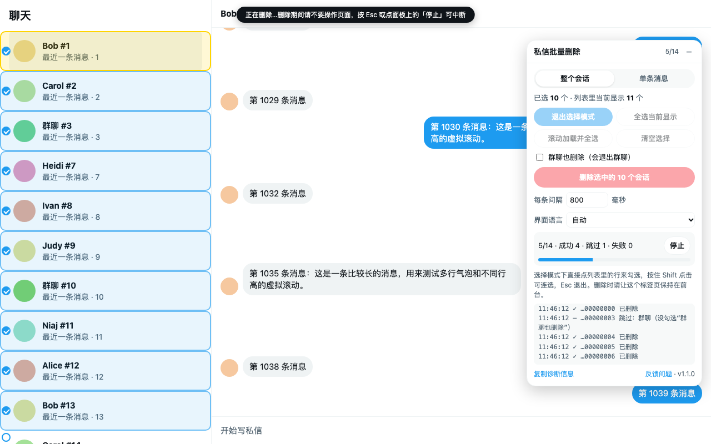

<p align="center"></p>
<h1 align="center">X 私信批量删除</h1>
<p align="center">在 X（Twitter）私信页批量勾选并删除单条消息或整个会话</p>
<p align="center">
  <a href="https://chromewebstore.google.com/detail/dm-bulk-delete-for-x/ohiiccddhenbgfbgachigngnggjcgoeo"><b>Chrome 网上应用店</b></a> ·
  <a href="https://greasyfork.org/en/scripts/604053-dm-bulk-delete-for-x"><b>Greasy Fork</b></a> ·
  <a href="https://llln-j.github.io/x-dm-bulk-delete/"><b>官网（英文）</b></a>
</p>
<p align="center"><a href="README.md">English</a> · <b>简体中文</b></p>



X 的私信（现在叫 Chat，地址 `x.com/i/chat`）只能一条条删。这个扩展在私信页加一个悬浮面板，让你：

- **批量删除整个会话**：在会话列表里勾选多个，一次删完；「消息请求」列表同样支持；群聊可选择一并退出
- **批量删除单条消息**：在对话里勾选多条，可选「仅为我删除」或「为所有人删除」

所有处理都在你的浏览器里完成：扩展自己不发任何网络请求，不用任何统计服务，数据不会离开你的设备。免费开源，使用 MIT 许可证。

> [!WARNING]
> 删除不可撤销，扩展也不会保留任何副本。开始前请先保存需要留存的内容，见[开始之前](#开始之前)。

[安装](#安装) · [使用](#使用) · [开始之前](#开始之前) · [工作原理](#工作原理) · [隐私与权限](#隐私与权限) · [常见问题](#常见问题) · [开发](#开发) · [许可证](#许可证)

## 安装

| 方式 | 步骤 |
| --- | --- |
| **Chrome 网上应用店**<br>Chrome 及其他 Chromium 内核浏览器 | 打开[商店页面](https://chromewebstore.google.com/detail/dm-bulk-delete-for-x/ohiiccddhenbgfbgachigngnggjcgoeo)，点「添加至 Chrome」，之后浏览器会自动更新 |
| **油猴脚本**<br>Chrome / Edge / Firefox / Safari | 先装 [Tampermonkey](https://www.tampermonkey.net/) 或 [Violentmonkey](https://violentmonkey.github.io/)，再到 [Greasy Fork](https://greasyfork.org/en/scripts/604053-dm-bulk-delete-for-x) 点「Install this script」，或者直接点 GitHub 上的 [一键安装](https://raw.githubusercontent.com/LLLn-J/x-dm-bulk-delete/userscript/x-dm-bulk-delete.user.js)。两个来源装一个即可，之后会自动更新。在 Chrome 和 Edge 里，脚本管理器可能会先要求你允许用户脚本，按它的提示操作即可 |
| **手动加载**<br>Chrome（加载已解压的扩展程序） | 从 [Releases](https://github.com/LLLn-J/x-dm-bulk-delete/releases/latest) 下载 zip 并解压 → 打开 `chrome://extensions` → 打开「开发者模式」→「加载已解压的扩展程序」选解压出的文件夹。手动加载的版本不会自动更新，新版本请到 Releases 下载 |

装好后打开 <https://x.com/i/chat>，页面右上角会出现「私信批量删除」面板。

## 使用

### 删除整个会话

1. 面板切到「整个会话」，点「进入选择模式」
2. 直接点左侧列表里的会话来勾选；再点一次取消，按住 Shift 点击可以连选一段
   - 「全选当前显示」：勾选列表里正显示的会话
   - 「滚动加载并全选」：自动往下滚动，加载全部会话并全部勾选
3. 群聊在 X 里对应的是「离开对话」，默认跳过；勾上「群聊也删除（会退出群聊）」才会处理
4. 点「删除选中的 N 个会话」，按钮会变成「再点一次：确认删除……（不可撤销）」，再点一次才会开始删除

### 删除单条消息



1. 先打开一个对话，面板切到「单条消息」，进入选择模式
2. 点消息行勾选（Shift 连选），或用「全选当前显示」「加载全部历史并全选」；「全选时」可限定只选我发的或只选对方发的
3. 选删除方式：
   - **仅为我删除**：只从你这边消失，对方仍能看到；任何消息都能这么删
   - **为所有人删除（不行就仅为我）**：自己发的消息为所有人删除，对方的消息退回为仅为我删除
   - **只为所有人删除（不行就跳过）**：对方的消息直接跳过
4. 点删除并再次确认

### 删除过程中



- 页面被一层透明遮罩挡住，防止误触打断流程；按 Esc 或点「停止」随时中断
- 请让标签页保持在前台：切到后台或窗口被挡住时会自动暂停，切回来继续
- 每条默认间隔 800 毫秒（带随机抖动），数量很多时别调太低，以免触发 X 的频率限制
- 失败的项目标红并保持勾选，可直接再删一次；连续失败 3 次会自动停下
- 面板会显示进度（成功、跳过、失败的数量）和带时间的日志

面板有中文和英文两种界面：自动跟随 X 的界面语言（取不到时跟随浏览器语言），也可以在面板里的「界面语言」手动切换。

## 开始之前

- **删除不可撤销**：删掉的消息和会话无法恢复，扩展也不会做任何备份
- **先保存要留的内容**：例如在 X 的设置里申请下载你的数据存档（英文界面路径：Settings → Your account → Download an archive of your data），确认里面有你需要的内容后再删
- **对方仍保留自己的副本**：「仅为我删除」不会让对方那边的消息消失；删除会话也只是从你的收件箱移除，对方仍能看到
- **「为所有人删除」只对你自己发的消息有效**（群管理员在自己管理的群里也能删别人的）
- **不是 X 官方工具**：它依赖 X 自己的网页界面，X 改版后可能暂时失效，需要等扩展更新

## 工作原理

X 的私信现在是端到端加密的 X Chat，删除请求需要客户端用你的密钥签名，直接调接口做不到。所以扩展做的是：在 X 自己的界面上替你依次点「更多 → 删除 → 只有我 / 每个人」，会话则是「右键 → 删除对话 → 确认」，和手动操作完全一样，只是自动化了。

X Chat 渲染在 shadow DOM 里，扩展用的元素标识（`data-testid` 等）和 42 种界面语言的按钮文字，都取自 X Chat 前端代码本身。

## 隐私与权限

所有处理都在你的浏览器里完成：扩展自己不发任何网络请求，不使用统计、广告或第三方服务，不读取、不保存消息正文；代码全部打包在扩展里，不加载远程代码。

- **`storage` 权限**：扩展声明的唯一权限，用来在本机的 `chrome.storage.local` 保存面板设置（删除方式、间隔时间、面板位置）；不会同步到别处，卸载扩展即清除。油猴脚本把同样的设置存在页面的 `localStorage` 里
- **网站访问：仅限 `x.com` 和 `twitter.com`**：内容脚本只在 `https://x.com/*` 和 `https://twitter.com/*` 上运行，扩展不申请其他任何网站的访问权限；安装时 Chrome 会提示它可以读取和更改这两个网站上的数据。这是显示面板、替你点击 X 菜单所必需的，面板本身只在私信页（`x.com/i/chat`）出现。油猴脚本同样只在这两个网站上运行
- **会读取什么**：会话和消息在页面里的内部 ID、位置，以及消息是不是你发的；这些只留在当前页面的内存里，关闭或刷新页面即消失

完整说明见 [PRIVACY.md](PRIVACY.md)。

## 常见问题

- **面板没出现**：确认打开的是 `x.com/i/chat`，面板只在私信页显示
- **提示页面上没有会话列表**：窗口太窄时，请先回到会话列表
- **连续失败 3 次后自动停下**：可能是 X 改了界面或触发了频率限制；稍后再试，也可以把「每条间隔」调大一些
- **X 改版后失效**：点面板底部「复制诊断信息」，[提交 issue](https://github.com/LLLn-J/x-dm-bulk-delete/issues/new/choose) 时贴上（里面只有页面结构统计和日志，不含消息内容）

## 开发

```text
x-dm-bulk-delete/        扩展本体（Chrome 里加载这个文件夹）
  manifest.json, _locales/, popup.html, popup.js, icons/
  src/labels.js          42 种界面语言的按钮文字（tools/update_labels.py 生成）
  src/core.js            穿透 shadow DOM 的查询、模拟鼠标事件、设置存储
  src/i18n.js            面板文字（中文 / English）和界面语言判断
  src/xchat.js           X Chat 的页面结构和删除流程
  src/ui.js              面板、勾选标记、选择模式、删除队列
  src/main.js            入口
test/                    仿 X Chat 结构的本地测试页
store/                   商店截图、宣传图和上架文案
tools/                   打包、生成素材、更新文案的脚本
docs/                    官网落地页（GitHub Pages）和 PUBLISHING.md（发布流程）
```

- **本地测试**：在项目根目录运行 `python3 -m http.server 8765`，打开 <http://localhost:8765/test/mock-xchat.html>。参数 `?lang=en` 切英文界面，`?variant=old` 切旧版消息菜单，`?userscript` 改为加载 `dist/` 里打包好的油猴脚本（需先打包）
- **打包**：`python3 tools/build.py`，检查 manifest、简介长度和 JS 语法后，在 `dist/` 生成商店 zip 和油猴脚本；CI 跑的也是这条命令
- **商店素材**：`python3 tools/make_store_assets.py`（需要本机装有 Chrome）
- **更新按钮文字**：X 改了文案时运行 `python3 tools/update_labels.py`
- **官网落地页**：`docs/` 里的静态文件，由 GitHub Pages 从 `main` 分支的 `/docs` 发布；Chrome 网上应用店链接在 `docs/config.js` 里设置。本地预览：运行 `python3 -m http.server 8000 --directory docs`，打开 <http://localhost:8000/>
- **发布**：见 [docs/PUBLISHING.md](docs/PUBLISHING.md)

## 许可证

[MIT](LICENSE)。本项目与 X Corp. 无关，不是 X 官方产品；X 是 X Corp. 的商标。
